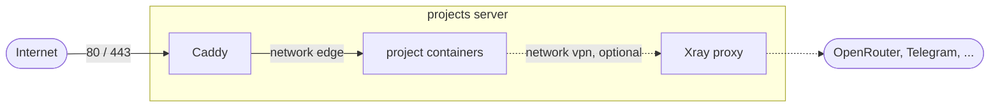

<div align="center">

# infra-server

Shared Caddy front door and VPN egress for a small self-hosted projects server.

[](https://github.com/aimuzov-projects/infra-server/actions/workflows/deploy.yml)
[](LICENSE)


**English** · [Русский](README.ru.md)

</div>

---

One Caddy owns ports 80/443 on the server, issues TLS certificates and routes each domain to its
project's container. Projects never publish ports and never touch each other: the only place
that knows which domain goes where is [`sites/`](sites).



## Sites

| Domain | Project | Containers |
| --- | --- | --- |
| [tatiana-shkatova.ru](https://tatiana-shkatova.ru) | [aimuzov-projects/shkatova-psychologist](https://github.com/aimuzov-projects/shkatova-psychologist) | `shkatova-psychologist`, `shkatova-chat` |
| [taplist.aimuzov.online](https://taplist.aimuzov.online) | [aimuzov-projects/community-taplist](https://github.com/aimuzov-projects/community-taplist) | `community-taplist`, `community-taplist-api` |
| [codenames.aimuzov.online](https://codenames.aimuzov.online) | [aimuzov-projects/codenames](https://github.com/aimuzov-projects/codenames) | `codenames`, `codenames-relay` |
| [logist.aimuzov.online](https://logist.aimuzov.online) | [aimuzov-projects/prestige-logist](https://github.com/aimuzov-projects/prestige-logist) | `prestige-logist`, `prestige-logist-api` |
| [sublya.aimuzov.online](https://sublya.aimuzov.online) | [aimuzov-projects/sublya](https://github.com/aimuzov-projects/sublya) | `sublya-site`, `sublya-tunnel` |
| [lazyvimx.aimuzov.online](https://lazyvimx.aimuzov.online) | [lazyvimx/site](https://github.com/lazyvimx/site) | `lazyvimx-site` |

## Repository layout

```
Caddyfile                 shared snippet (compression, security headers) + import of sites/
sites/<project>.caddy     one file per site: domain → container
compose.yml               caddy and vpn services
deploy/remote.sh          deploy script, runs on the server
deploy/site.sh            deploy of every site: starts site-deploy@<project> and shows its log
deploy/site-build.sh      the build itself, inside site-deploy@.service
ssh/10-no-passwords.conf  sshd: keys only, no passwords; applied on every deploy
vpn/update.sh             builds the Xray config from the subscription
vpn/vpn-update.{service,timer}   daily config refresh
docker/docker-prune.{service,timer}   weekly cleanup of the Docker build cache
.env.example              secrets template (the real .env lives only on the server)
```

## Server conventions

```
/srv/
  infra-server/     ← this repo
  <project>/        ← clone of the project repo, built and run in place
```

- Repos are named `<space>-<project>`: `infra-server`, `infra-site-template`,
  `infra-site-kit`, `shkatova-psychologist`. The server folder mirrors the repo name.
- One project — one folder `/srv/<project>` and one compose project with an explicit `name:`.
  Containers, volumes and networks get the project prefix, so projects never collide.
- Projects publish no host ports. They join the external `edge` network and Caddy reaches them by
  container name.
- A project never writes outside its folder.
- Sites deploy with one script, [`deploy/site.sh`](deploy/site.sh), the key of a site runs it with
  the project name and the release tag Actions sends as the ssh command (without one, the newest
  `main`). The build runs in the systemd unit `site-deploy@<project>`, so a dropped SSH
  connection doesn't stop it, and `site.sh` streams its log to Actions. The lock
  `/tmp/sites-deploy.lock` lets the server build one site at a time, so a merge into several repos
  at once doesn't build them in parallel on the small server. The log of the last deploys:
  `journalctl -u site-deploy@<project>`.
- Every repo, public ones included, is pulled over SSH with its own read-only deploy key. Deploy
  keys must be enabled for the organization (`deploy_keys_enabled_for_repositories`).

## Deploy

A push to `main` triggers GitHub Actions: `shellcheck` and `caddy validate` first, then an SSH
login to the server. There the key is pinned to [`deploy/remote.sh`](deploy/remote.sh), which
pulls `main`, refreshes the VPN egress and applies the Caddy config. A broken config never
replaces the running one. To redeploy without a push:

```bash
gh workflow run deploy.yml
```

The key in the server's `authorized_keys` is restricted to a single command:

```
command="git -C /srv/infra-server pull --ff-only --quiet && /srv/infra-server/deploy/remote.sh",restrict ssh-ed25519 ... github-actions@infra-server
```

Its private half is the `DEPLOY_SSH_KEY` repository secret.

## Secrets

Nothing secret is committed. Secrets live in `/srv/infra-server/.env` (template:
[`.env.example`](.env.example)):

| Variable | Used by |
| --- | --- |
| `VPN_SUBSCRIPTION_URL` | `vpn/update.sh` — subscription the Xray config is built from |
| `TAPLIST_EDITOR_HASH` | `sites/community-taplist.caddy` — bcrypt hash for the editor's `basic_auth` |

To give a site its own secret, reference it as `{$NAME}` in `sites/<project>.caddy` and pass it to
the `caddy` service in `compose.yml` one by one, so the rest of `.env` stays out of Caddy:

```yaml
environment:
  NAME: ${NAME:?NAME is not set, see .env.example}
```

Values containing `$` (bcrypt hashes) go in single quotes. A password hash is made with:

```bash
docker run --rm -it caddy:2.11-alpine caddy hash-password
```

## Adding a project

1. In the project's compose: `name: <project>`, a unique `container_name` per service, the `edge`
   network as `external: true`, no `ports:`.
2. Create a deploy key on the server:

   ```bash
   ssh projects 'ssh-keygen -q -t ed25519 -N "" -C "projects-server:<project>" -f ~/.ssh/<project> &&
     printf "Host github-<project>\n\tHostName github.com\n\tUser git\n\tIdentityFile ~/.ssh/<project>\n\tIdentitiesOnly yes\n\n" >> ~/.ssh/config &&
     cat ~/.ssh/<project>.pub'
   ```

   and add the public key to the repo:

   ```bash
   gh repo deploy-key add key.pub -R <org>/<repo> --title projects-server
   ```

3. Clone and start the project:

   ```bash
   ssh projects git clone github-<project>:<org>/<repo>.git /srv/<project>
   ```

4. For a site, let its GitHub Actions deploy: add the public half of a new key to
   `/root/.ssh/authorized_keys` and the private half to the repo secret `DEPLOY_SSH_KEY`:

   ```
   command="/srv/infra-server/deploy/site.sh <project>",restrict ssh-ed25519 ... github-actions@<project>
   ```

5. Add `sites/<project>.caddy` with `import common` and `reverse_proxy <container_name>:<port>`,
   point the domain's DNS at the server and push to `main`.

## VPN egress

The server is hosted in Russia, where some external APIs (OpenRouter, Telegram) are unreachable.
The `vpn` container runs Xray with an HTTP proxy on `vpn:3128` and SOCKS on `vpn:1080`, using the
"Всё и сразу" profile from the subscription as is: Russian addresses go direct, the rest through
European nodes, with fallback chains if those are down.

Projects opt in from their compose:

```yaml
services:
  app:
    environment:
      HTTPS_PROXY: http://vpn:3128
      NODE_USE_ENV_PROXY: '1' # Node 24+ only: without it fetch ignores the proxy
    networks:
      - vpn

networks:
  vpn:
    name: vpn
    external: true
```

`vpn/update.sh` rebuilds the config on every deploy and once a day via `vpn-update.timer`. Check
from the server:

```bash
docker run --rm --network vpn curlimages/curl -sx http://vpn:3128 https://www.cloudflare.com/cdn-cgi/trace
```

## Server from scratch

1. Docker Engine from the docker.com apt repository, plus `apt install jq`.
2. Firewall: `ufw allow 22/tcp`, `ufw allow 80/tcp`, `ufw allow 443` (TCP and UDP for HTTP/3).
3. Networks: `docker network create edge` and `docker network create vpn`.
4. Deploy key for this repo (see [Adding a project](#adding-a-project)), then
   `git clone github-infra-server:aimuzov-projects/infra-server.git /srv/infra-server`.
5. `/srv/infra-server/.env` from [`.env.example`](.env.example), then run `deploy/remote.sh` once.
6. Shell: root gets fish from [dotfiles](https://github.com/aimuzov/dotfiles/blob/main/docs/fish/README.md#linux-server),
   bash stays the login shell and an interactive SSH login switches to fish. Install the
   `chezmoi_<version>_linux_amd64.deb` from [chezmoi releases](https://github.com/twpayne/chezmoi/releases)
   after checking it against `checksums.txt`, then
   `chezmoi init --apply --recurse-submodules=false https://github.com/aimuzov/dotfiles.git`.
   After that every deploy of this repo runs `chezmoi update`, so changes of the dotfiles get
   here with the next deploy (or `gh workflow run deploy.yml`).

## License

[MIT](LICENSE)
