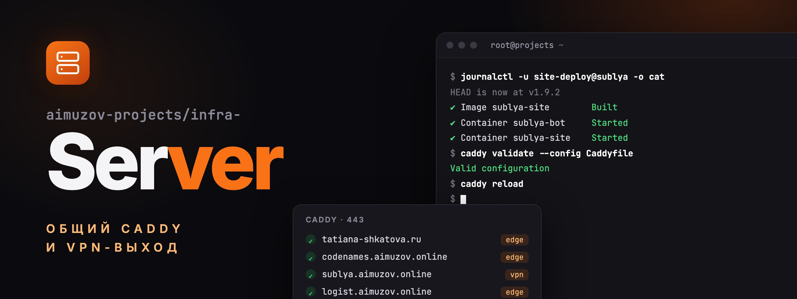
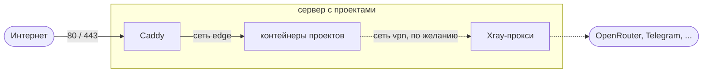

<p align="center">
	<a href="README.md"></a>
	
</p>

<p align="center">
	
</p>

<p align="center">
	<a href="https://github.com/aimuzov/infra-server/actions/workflows/deploy.yml"></a>
	<a href="https://caddyserver.com"></a>
	<a href="https://github.com/XTLS/Xray-core"></a>
	<a href="https://docs.docker.com/compose/"></a>
	<a href="LICENSE"></a>
</p>

<h3 align="center">Общий Caddy и VPN-выход для небольшого сервера с проектами</h3>
<p align="center">Один Caddy на 80/443, у каждого проекта своя папка и свой compose-проект, деплой из GitHub Actions по SSH</p>

Один Caddy держит 80/443, выпускает сертификаты и раскидывает домены по контейнерам проектов.
Проекты не публикуют порты и не знают друг о друге: какой домен куда идёт, знает только
[`sites/`](sites).



## Сайты

| Домен                                                          | Проект                                                                            | Контейнеры                                   |
| -------------------------------------------------------------- | --------------------------------------------------------------------------------- | -------------------------------------------- |
| [tatiana-shkatova.ru](https://tatiana-shkatova.ru)             | [aimuzov/shkatova-psychologist](https://github.com/aimuzov/shkatova-psychologist) | `shkatova-psychologist`, `shkatova-chat`     |
| [taplist.aimuzov.online](https://taplist.aimuzov.online)       | [aimuzov/community-taplist](https://github.com/aimuzov/community-taplist)         | `community-taplist`, `community-taplist-api` |
| [codenames.aimuzov.online](https://codenames.aimuzov.online)   | [aimuzov/codenames](https://github.com/aimuzov/codenames)                         | `codenames`, `codenames-relay`               |
| [logist.aimuzov.online](https://logist.aimuzov.online)         | [aimuzov/prestige-logist](https://github.com/aimuzov/prestige-logist)             | `prestige-logist`, `prestige-logist-api`     |
| [sublya.aimuzov.online](https://sublya.aimuzov.online)         | [aimuzov/sublya](https://github.com/aimuzov/sublya)                               | `sublya-site`, `sublya-tunnel`               |
| [lazyvimx.aimuzov.online](https://lazyvimx.aimuzov.online)     | [lazyvimx/site](https://github.com/lazyvimx/site)                                 | `lazyvimx-site`                              |
| [wodlog.aimuzov.online](https://wodlog.aimuzov.online)         | [aimuzov/wodlog](https://github.com/aimuzov/wodlog)                               | `wodlog`, `wodlog-api`                       |
| [sorebody.aimuzov.online](https://sorebody.aimuzov.online)     | [aimuzov/sorebody](https://github.com/aimuzov/sorebody)                           | `sorebody`, `sorebody-api`                   |
| [kaiten-mcp.aimuzov.online](https://kaiten-mcp.aimuzov.online) | [aimuzov/kaiten-mcp](https://github.com/aimuzov/kaiten-mcp)                       | `kaiten-mcp`                                 |
| [thinks-mcp.aimuzov.online](https://thinks-mcp.aimuzov.online) | [aimuzov/thinks-mcp](https://github.com/aimuzov/thinks-mcp)                       | `thinks-mcp`                                 |

## Что где лежит

```
Caddyfile                 общий сниппет (сжатие, заголовки безопасности) и импорт sites/
sites/<project>.caddy     по файлу на сайт: домен → контейнер
compose.yml               сервисы caddy и vpn
deploy/remote.sh          выкладка, выполняется на сервере
deploy/site.sh            выкладка любого сайта: запускает site-deploy@<project> и показывает его лог
deploy/site-build.sh      сама сборка, внутри site-deploy@.service
deploy/site-deploy@.service   systemd-юнит сборки сайта, переживает обрыв SSH
ssh/10-no-passwords.conf  sshd: только ключи, без паролей; ставится при каждой выкладке
vpn/update.sh             собирает конфиг Xray из подписки
vpn/vpn-update.{service,timer}   обновление конфига раз в сутки
docker/docker-prune.{service,timer}   чистка кэша сборки Docker раз в неделю
.env.example              образец секретов (настоящий .env есть только на сервере)
```

## Как устроен сервер

```
/srv/
  infra-server/     ← этот репо
  <project>/        ← клон репо проекта, там же собирается и запускается
```

- Репо называются `<пространство>-<проект>`: `infra-server`, `infra-site-template`,
  `infra-site-kit`, `shkatova-psychologist`. Папка на сервере повторяет имя репо.
- Один проект -- одна папка `/srv/<project>` и один compose-проект с явным `name:`. Контейнеры,
  тома и сети получают префикс проекта, поэтому проекты не пересекаются.
- Проекты не публикуют порты на хост. Они подключаются к внешней сети `edge`, Caddy ходит к ним
  по имени контейнера. Исключение одно: TURN голосового чата codenames (`codenames-turn`,
  `network_mode: host`) слушает 3478 TCP/UDP и UDP 49160-49999, через Caddy такое не проксируется.
- Проект не пишет за пределы своей папки.
- Сайты выкладываются одним скриптом, [`deploy/site.sh`](deploy/site.sh), ключ сайта запускает его
  с именем проекта и тегом релиза, который Actions передаёт командой ssh: `v1.2.0` или в монорепо
  `docs-v1.2.0` (без тега -- свежий `main`).
  Сборка идёт в systemd-юните `site-deploy@<project>`, поэтому обрыв SSH её не
  останавливает, а `site.sh` транслирует её лог в Actions. Lock `/tmp/sites-deploy.lock` даёт серверу
  собирать по одному сайту, поэтому мерж сразу в несколько репо не собирает их параллельно на
  маленьком сервере. Лог последних выкладок: `journalctl -u site-deploy@<project>`.
- Каждый репо, публичный тоже, тянется на сервер по SSH своим read-only deploy key. В
  организации должны быть разрешены deploy keys (`deploy_keys_enabled_for_repositories`).

## Выкладка

Пуш в `main` запускает GitHub Actions: сначала `shellcheck` и `caddy validate`, затем вход по SSH
на сервер. Там ключ привязан к [`deploy/remote.sh`](deploy/remote.sh): он подтягивает `main`,
обновляет VPN-выход и применяет конфиг Caddy. Битый конфиг работающий не заменит. Повторить
выкладку без пуша:

```bash
gh workflow run deploy.yml
```

Ключ в `authorized_keys` сервера ограничен одной командой:

```
command="git -C /srv/infra-server pull --ff-only --quiet && /srv/infra-server/deploy/remote.sh",restrict ssh-ed25519 ... github-actions@infra-server
```

Приватная половина лежит в секрете `DEPLOY_SSH_KEY` репозитория.

## Секреты

В git секретов нет. Они лежат в `/srv/infra-server/.env` (образец --
[`.env.example`](.env.example)):

| Переменная                               | Кто читает                                                                           |
| ---------------------------------------- | ------------------------------------------------------------------------------------ |
| `VPN_SUBSCRIPTION_URL`                   | `vpn/update.sh` -- подписка, из которой собирается конфиг Xray                       |
| `TAPLIST_EDITOR_HASH`                    | `sites/community-taplist.caddy` -- bcrypt-хеш для `basic_auth` редактора             |
| `REABICA_AUTH_USER`, `REABICA_AUTH_HASH` | `sites/reabica.caddy` -- логин и bcrypt-хеш для `basic_auth`, закрывающего весь сайт |

Свой секрет сайту: сослаться на него как `{$NAME}` в `sites/<project>.caddy` и передать сервису
`caddy` в `compose.yml` поштучно, чтобы остальной `.env` в Caddy не попадал:

```yaml
environment:
  NAME: ${NAME:?NAME is not set, see .env.example}
```

Значения с `$` (bcrypt-хеши) -- в одинарных кавычках. Хеш пароля:

```bash
docker run --rm -it caddy:2.11-alpine caddy hash-password
```

## Новый проект

1. В compose проекта: `name: <project>`, у каждого сервиса уникальный `container_name`, сеть
   `edge` как `external: true`, без `ports:`.
2. Deploy key на сервере:

   ```bash
   ssh projects 'ssh-keygen -q -t ed25519 -N "" -C "projects-server:<project>" -f ~/.ssh/<project> &&
     printf "Host github-<project>\n\tHostName github.com\n\tUser git\n\tIdentityFile ~/.ssh/<project>\n\tIdentitiesOnly yes\n\n" >> ~/.ssh/config &&
     cat ~/.ssh/<project>.pub'
   ```

   Публичный ключ -- в репо:

   ```bash
   gh repo deploy-key add key.pub -R <org>/<repo> --title projects-server
   ```

3. Клонировать проект:

   ```bash
   ssh projects git clone github-<project>:<org>/<repo>.git /srv/<project>
   ```

   Если в репо есть `.env.example`, заполнить по нему `/srv/<project>/.env`: без этого файла
   сборка остановится до compose.

4. Для сайта -- пустить выкладку из его GitHub Actions: публичную половину нового ключа дописать в
   `/root/.ssh/authorized_keys`, приватную положить в секрет репо `DEPLOY_SSH_KEY`, затем
   выставить переменной репо `DEPLOY_ENABLED` значение `true`: без неё сайты из
   infra-site-template пропускают джобу деплоя:

   ```
   command="/srv/infra-server/deploy/site.sh <project>",restrict ssh-ed25519 ... github-actions@<project>
   ```

5. Добавить `sites/<project>.caddy` с `import common` и `reverse_proxy <container_name>:<port>`,
   направить DNS домена на сервер и запушить `main`. `common` ставит заголовки безопасности,
   собственный `Permissions-Policy` сайта важнее, см. [`codenames.caddy`](sites/codenames.caddy).
6. Первая сборка: запустить Release сайта вручную или `ssh projects /srv/infra-server/deploy/site.sh <project>`.

## VPN-выход

Сервер стоит в РФ, и часть внешних API (OpenRouter, Telegram) отсюда недоступна. Для этого есть
контейнер `vpn`: Xray с HTTP-прокси `vpn:3128` и SOCKS `vpn:1080` на профиле "Всё и сразу" из
подписки. Маршруты профиля остаются как есть: российские адреса идут напрямую, остальное через
европейские ноды, а если они лежат -- через запасные цепочки.

Проект подключается по желанию, в своём compose:

```yaml
services:
  app:
    environment:
      HTTPS_PROXY: http://vpn:3128
      NODE_USE_ENV_PROXY: "1" # только для Node 24+: без этого fetch прокси не видит
    networks:
      - vpn

networks:
  vpn:
    name: vpn
    external: true
```

Конфиг пересобирает `vpn/update.sh` на каждой выкладке и раз в сутки по `vpn-update.timer`.
Проверка с сервера:

```bash
docker run --rm --network vpn curlimages/curl -sx http://vpn:3128 https://www.cloudflare.com/cdn-cgi/trace
```

## Сервер с нуля

1. Docker Engine из apt-репозитория docker.com и `apt install jq`.
2. Файрвол: `ufw allow 22/tcp`, `ufw allow 80/tcp`, `ufw allow 443` (TCP и UDP для HTTP/3),
   для TURN codenames `ufw allow 3478` и `ufw allow 49160:49999/udp`.
3. Сети: `docker network create edge` и `docker network create vpn`.
4. Deploy key для этого репо (см. [Новый проект](#новый-проект)), затем
   `git clone github-infra-server:aimuzov/infra-server.git /srv/infra-server`.
5. `/srv/infra-server/.env` по образцу [`.env.example`](.env.example), затем один раз
   `deploy/remote.sh`.
6. Оболочка: root получает fish из [dotfiles](https://github.com/aimuzov/dotfiles/blob/main/docs/fish/README.ru.md#linux-сервер),
   bash остаётся login shell, а интерактивный вход по SSH переключается в fish. Поставить
   `chezmoi_<version>_linux_amd64.deb` из [релизов chezmoi](https://github.com/twpayne/chezmoi/releases),
   сверив его с `checksums.txt`, затем
   `chezmoi init --apply --recurse-submodules=false https://github.com/aimuzov/dotfiles.git`.
   Дальше каждый деплой этого репо делает `chezmoi update`, так что правки dotfiles приезжают
   со следующим деплоем (или `gh workflow run deploy.yml`).

## Лицензия

[MIT](LICENSE)
